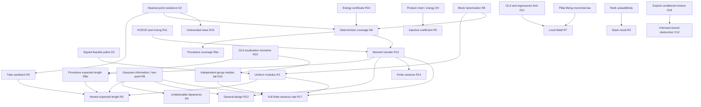

# Proof-dependency audit

Stable IDs refer to `theorem_inventory.md` and `essential_claim_inventory.md`. Final printed numbers are generated in `theorem_number_map.json`. The two parts of the procedure theorem are deliberately separated, so reuse of its deterministic coverage argument in the transfer theorem creates no circular expected-length proof.

| Result | Depends on | Dependency verified? | External theorem | External assumptions verified? |
|---|---|---|---|---|
| R1 | R8, D3, D4; orthogonal projections, finite sums | Yes; complete signed-path proof | None essential; osculating geometry is prior art | No borrowed differentiability hypothesis |
| R2 | Rank subadditivity; elementary basis spans H | Yes | None | Not applicable |
| R3 | R1, R9, D5, R6b | Yes; upper/lower class and loading factors match | Generic modulus principle credited, proof reproduced | No convexity assumption imported |
| R4 | R9, explicit tube alternative | Yes; eta=o(t_n) gives KL→0 | None beyond proved two-point calculation | Same sigma and design law checked |
| R5 | D4, compact unit spheres, injective norm identity | Yes | Hillar–Lim Theorem 1.10 for inherited hardness | Arbitrary variable-size 3-tensor embedded; no extra internal TT caps |
| R6a | D2, R8, R16, valid ball | Yes | Gaussian orthogonal projections | Full-rank X, conditional N(0,sigma²I), residual df>0 |
| R6b | R10, R12 | Yes | None beyond checked localizer | Integer moments through max(J,2); sample condition verified |
| R7 | D11, D12, polynomial expansion | Yes | Pillai–Meng Theorem 2.1 | Three unit positive exponents; identity covariance; exact c=0 only |
| R8 | Successive matrix rank-one factorizations | Yes | None | Nonzero case and zero separated |
| R9 | Conditional Gaussian KL; Pinsker | Yes; Pinsker verification in proof audit | Information contraction/log-sum | Common design law and finite second moment for finite KL |
| R10 | Gaussian projection law; chi-square density integral | Yes | Wishart distribution via Gaussian columns | iid normal design; n−p+1>k; fixed moment order |
| R11 | Projection optimality; orthogonal telescoping; cross-line operator norm | Yes, independently derived | No HOSVD theorem imported | No global best tensor approximation assumed |
| R12 | D6, R11, actual localization moments | Yes, no cycle | None | Ball coverage and moments are explicit premises |
| R13 | Conditional projection law, Gram assumptions, R12 and R9 | Yes | Gaussian covariance example checked using congruence | Law of X independent of B,sigma; inverse moments explicit |
| R14 | Conditional covariance; trace; Markov; R12 | Yes | None beyond elementary inequalities | Known upper scale; mean zero; trace moment only for length |
| R15 | Closed rank class, bounded minimizing sequence | Yes | Finite-dimensional subsequence compactness | No infinite-dimensional extension |
| R16 | D4, elementary-symmetric energy inequality | Yes, averaging proof included | None; classical inequality proved directly | Nonnegative squared block norms; rho<shat |

No empirical-process, entropy, covering-number, chaining, Donsker, Fano, Assouad, PAC-Bayes, martingale or optimization-convergence theorem is used by the current proofs. There is therefore no unchecked application of those theories to list. Their possible usefulness for a future growing-dimensional or robust extension does not make them ingredients of the present theorem.

Audit completion adds R17 (independent finite-variance full-rate theorem): dependencies R10's group inverse-moment calculation, independent-group median majority bound D15, R12, R1, R9 and D5. All are proved. No external robust-mean theorem is needed. The Gaussian lower bound is invoked through its direct two-point calculation, not through a procedure with a different sample threshold. C12/D16 uses only the explicit conditional mixture, a product-law coupling bound and Tonelli; the classical reference supplies historical context, not a missing proof step.
